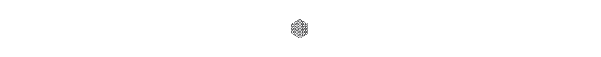

“SWAG”, “帥”, “Endao”(“handsome” in Taiwanese), whatever you call it.

*文明的演進終將引領我們邁入極高端科技和極低端生活？ Photo by [Benjamin Hung](http://www.benjamin-hung.com) on [Unsplash](https://unsplash.com/s/photos/cyberpunk)*

> 本文同步收錄在 [Medium](https://medium.com/space-cat/%E6%9C%80%E9%BE%90%E5%85%8B%E7%9A%84-vs-code-%E4%B8%BB%E9%A1%8C-make-your-editor-rock-in-a-synthwave-way-cb375c8d40da)

於我而言，身為一位程式人的標誌性美德應當是：  
『永不停止追求卓越和炫砲。』

與此同時，在[**鄙視鏈**](https://vinta.ws/blog/695)中謀求一個安穩而適切的定位，也是我日以繼夜努力的目標。初出社會第一天就深刻的體認到，尊重是自己掙來的，同情是弱者摔來的。

*__Respect? None of us deserve it for free!__*

從這十年淺薄的社會歷練中，我歸納出簡單幾個防鄙視步驟和大家分享：

1. 焚膏繼晷地努力。

2. 夙夜匪懈地裝逼。

好，  
以上。

相信只要熟記這幾點，爾後你各位的人生路上絕對可以少繞點彎路。

**第一印象**影響既深且遠，為了贏得基本的尊重，絕對是不容輕忽。儘管學術界已有諸多關於此方面的[研究](https://zh.wikipedia.org/wiki/%E5%B9%B2%E6%93%BE%E7%90%86%E8%AB%96)支持這個論點，許多人還是不甚瞭解裝逼的價值。

> 希望在足夠影響你人生軌跡的**炫技時刻**降臨之際，身上的技術和手邊的工具已經打磨得足夠鋒利。



不諱言，像我如此虛華的男子，一個所謂稱手的工具，首先必須得浮誇。

上個月我從用了兩年的 Sublime text 3 跳槽到 [Visual Studio Code](https://code.visualstudio.com)，主要就是被那蓬勃發展的熱情開源組和帥氣的介面和給煞到❤️。

最近發現的 VS Code 主題又將我整個逼數提升到新境界：

## [SynthWave ‘84](https://marketplace.visualstudio.com/items?itemName=RobbOwen.synthwave-vscode&ssr=false#overview)

[**SynthWave '84 - Visual Studio Marketplace**](https://marketplace.visualstudio.com/items?itemName=RobbOwen.synthwave-vscode)

此主題風格係受到名為 [**Synthwave**](https://en.wikipedia.org/wiki/Synthwave) 的音樂曲風和賽博龐克 (Cyberpunk) 風格啟發，在後工業時代反烏托邦氛圍的晦暗背景色中，霓虹般的文字彷彿象徵著極高端科技和極低端生活 (High tec, low life) 文明型態的矛盾和衝突。瀏覽過上百個主題，就這一家的語法高亮是**真的高亮**，繫好安全帶，讓我們一起向那狂放的 80 年代科幻致敬！

 via [Robb Owen](https://marketplace.visualstudio.com/publishers/RobbOwen)](https://cdn-images-1.medium.com/max/4606/1*Jt8F4MGn5puDOstW1udL1w.jpeg)*仔細看看那帶感的示範程式碼...* Credit to: [Robb Owen](https://marketplace.visualstudio.com/publishers/RobbOwen)


## 安裝方式

1. 下載主題 CSS

    在 VS Code extensions marketplace 中搜尋 SynthWave ’84 ，這邊我們參考主頁，直接到他的 [GitHub repostory](https://github.com/robb0wen/synthwave-vscode/edit/master/synthwave84.css) 複製下載 `synthwave84.css` 到自己覺得舒服的位置，方便日後調整 CSS 中的細節。
    > Mac OS 可在 Finder 中選取下載的檔案，輸入 `⌘ + ⌥ + C` 複製檔案路徑供後續編輯設定用。

2. 安裝 Custom CSS and JS Loader

    在 Extensions marketplace 搜尋並安裝 [Custom CSS and JS Loader](https://marketplace.visualstudio.com/items?itemName=be5invis.vscode-custom-css) 擴充套件，接著下一步編輯 settings.json 設定檔。

    *VS Code 左側 Extensions (`⇧` + `⌘` + `X`)按鈕可以快速搜尋套件*

3. 編輯 settings.json 設定檔

    VS Code 的所有相關設定都在這，各個套件也都共用此設定檔，我們可以從 Code > Preferences > settings(`⌘` + `,`)，透過 Extension 頁籤快速找到 *`Edit in settings.json`* 超連結：

    *Code > Preferences > settings*

    開啟 `settings.json` ，在主要的花括號 `{}` 內插入以下幾行：

    ```json
    // 啟動 Custom Css and Js extension
    "vscode_custom_css.policy": true,

    // 選擇要導入的 CSS 檔案位置，以 Mac OS 放置於 Documents 資料夾中為例：
    "vscode_custom_css.imports": [
    "file:///Users/steven_c/Documents/synthwave84.css"
    ],
    ```

4. 啟動炫砲的開關 **Turn on your neon dream**

    用熱鍵 `⌘` + `⇧` + `P` 召喚 VS Code 命令列，輸入 `Enable Custom Css and JS` 正式啟動炫砲的開關，接著編輯器會提示需要重新啟動。

    如果命運的齒輪沒有差錯的話⋯⋯

    > ## *Voila!*

    

5. CSS 細節調整

    仔細觀察 `synthwave84.css` 我們還可以看到一些騷包的細節：

    找到 `.monoaco-editor{background-image... }` 編輯器背景設定，可以調整低調的漸層色，我這邊的設定是仲夏時分的初入夜色。

    ```css
    /* Add the subtle gradient to the editor background */
    .monaco-editor {
    background-color: transparent !important;
    /* 背景顏色預設值，先註解起來留著 */
    /* background-image: linear-gradient(to bottom, #2a2139 75%, #34294f); */
    /* 修改成自己喜歡的背景顏色 */
    background-image: linear-gradient(to bottom, hsla(209, 100%, 16%, 0.836) 50%, #003c44);
    }
    ```

## 2019/05/06 更新

> ### 炫砲 2.0 - Show us your 80’s

搗鼓了背景圖更新升級，請搭配服用：

* [在VS Code上套用自己喜歡的背景圖片](https://medium.com/@chenghsuan.han/%E5%9C%A8vs-code%E4%B8%8A%E5%A5%97%E7%94%A8%E8%87%AA%E5%B7%B1%E5%96%9C%E6%AD%A1%E7%9A%84%E8%83%8C%E6%99%AF%E5%9C%96%E7%89%87-ae84b9f09ddf) by [Danny H.](https://medium.com/u/71a4721af49b)

* 背景音樂：[美秀集團 Amazing Show — 米兒 Mia feat.鄭小韻](https://youtu.be/nVjVpX3gRWk)

](https://cdn-images-1.medium.com/max/3058/1*ptB46lor7-2f5k30_wv-fg.jpeg)*炫砲 2.0 inspire by [美秀集團 — 米兒](https://youtu.be/nVjVpX3gRWk)*

*復古擋泥板 style feat. 周慧敏*


要知道，裝逼的機會俯拾皆是，欲裝其逼、先利其器。

不論你這個人內涵如何豐饒，技術有多精妙，在參加各式 Meet up 或讀書會時，初次見面的人們實際展開對話之前，首先還是從外表留下第一印象，這時候我們二話不說筆電抄起來直接開啟編輯器⋯⋯深厚底蘊，盡展無藏。

> #### *你將是、你就是一位足夠炫砲的文字工作者！*

如果這篇文章有幫助到你，下方**回應按鈕麻煩幫我按一個**，讓大家知道，炫砲路上我不孤單。

> ### 就這樣，我們路上見🙌


## 補充

* 數位時代 — 經理人月刊：[首因 / 近因效應 Primacy Effect/Recency Effect](https://www.managertoday.com.tw/glossary/view/171)

* Youtube 上的 Synthwave 歌單：[Best of Synthwave And Retro Electro [Part1]](https://youtu.be/85bkCmaOh4o)

* 更多賽博龐克(Cyberpunk)：[蒸汽龐克 & 賽博龐克探討與反思](https://medium.com/deerlight/%E8%92%B8%E6%B1%BD%E9%BE%90%E5%85%8B-%E8%B3%BD%E5%8D%9A%E9%BE%90%E5%85%8B-e327ee62d50a) by [Jhane Chou](https://medium.com/u/7c691143a681)

* 更多炫砲(Super rocket)：[美秀集團 Amazing Show — 電火王 King of Light (.aka KOL)](https://youtu.be/BuuIbTF0_b0)
